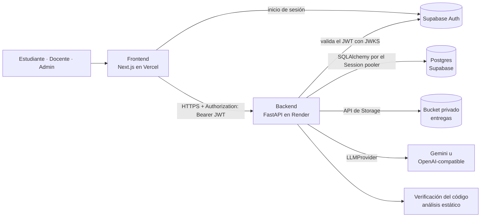

# Asesor Pedagógico Inteligente

[](https://github.com/lunamm25/Proyecto-final-IA/actions/workflows/ci.yml)

Plataforma web en la que el estudiante sube las evidencias de sus laboratorios del curso de IA
(cohortes 1 y 2) y una IA las analiza **criterio por criterio** con la rúbrica de cada
laboratorio: cita evidencias concretas y propone un nivel de desempeño. **La nota (0,0–5,0) la
calcula el backend**, nunca el modelo, y **el docente revisa, ajusta y aprueba** antes de
publicar (Human-in-the-Loop). Con las evaluaciones publicadas se arma un informe integral del
aprendizaje y un mapa interactivo de competencias.

Proyecto final · Profundización I – IA · Ingeniería de Sistemas y Telecomunicaciones ·
Universidad de Manizales · 2026.

## Demo

| | URL |
|---|---|
| Aplicación (frontend) | https://proyecto-final-ia-vaiw.vercel.app |
| API (backend) | https://proyecto-final-ia-i7jx.onrender.com — estado en [`/api/salud`](https://proyecto-final-ia-i7jx.onrender.com/api/salud), documentación interactiva en [`/docs`](https://proyecto-final-ia-i7jx.onrender.com/docs) |

> El backend está en el plan gratuito de Render: si estuvo inactivo, la primera petición puede
> tardar alrededor de un minuto mientras el servicio despierta. Antes de una demo, abre
> `/api/salud` y espera la respuesta.

## Funcionalidades

| Requisito | Qué hace |
|---|---|
| RF-01 Autenticación y roles | Registro e inicio de sesión (Supabase Auth). Roles `estudiante`, `docente` y `admin`; el backend valida el JWT y el rol en cada ruta. |
| RF-02 Cohortes y laboratorios | Cohortes 1 y 2 con sus laboratorios (descripción y objetivos), con datos semilla. |
| RF-03 Rúbricas | Extracción con IA desde el enunciado, validación automática de inconsistencias, edición y versiones inmutables. |
| RF-04 Portafolio | Entregas por laboratorio (PDF, ZIP y/o URL de GitHub) en un bucket privado, asociadas a la versión de rúbrica vigente. |
| RF-05 Evaluación con IA | Nivel por criterio con evidencias citadas y verificadas contra el material; salida validada con Pydantic; nota calculada por el backend. |
| RF-06 Verificación del código | Análisis estático del ZIP sin ejecutarlo (sintaxis, `ruff`, complejidad con `radon`, métricas, README/requirements/tests). |
| RF-07 Revisión docente | El docente ajusta niveles (motivo obligatorio), edita la retroalimentación, aprueba y publica. Todo queda en auditoría. |
| RF-08 Informe integral | Promedios y evolución calculados por el backend y una narrativa de la IA; se descarga en PDF. |
| RF-09 Mapa de competencias | Grafo interactivo temática → subtema → concepto → laboratorio con el nivel de dominio; se descarga en PNG o JSON. |
| RF-10 Configuración de IA | El admin elige proveedor, modelo y temperatura (≤ 0,2) y prueba la conexión. |
| RF-11 Proyecto y equipo | Página con el resumen del proyecto y las integrantes. |

El detalle y los criterios de aceptación están en [`docs/REQUISITOS.md`](docs/REQUISITOS.md) y el
estado de cada requisito en [`docs/PROGRESO.md`](docs/PROGRESO.md).

## Arquitectura

Un frontend, un backend y Supabase; sin microservicios ni colas externas.



| Capa | Tecnología | Despliegue |
|---|---|---|
| Frontend | Next.js (App Router) · TypeScript · Tailwind CSS · shadcn/ui · React Flow · Recharts | Vercel |
| Backend | Python 3.11 · FastAPI · Pydantic v2 · SQLAlchemy 2 | Render (Web Service) |
| Datos | Supabase: Postgres, Auth y Storage (bucket privado) | Supabase |
| IA | Capa `LLMProvider`: Gemini (por defecto `gemini-3.5-flash-lite`) u OpenAI-compatible (Ollama, Groq, OpenRouter) | Variables de entorno y panel de admin |
| Verificación | `ast` · `ruff` · `radon` (nunca ejecuta el código) | Backend |

### Flujo de una evaluación

1. El estudiante sube la entrega: el PDF y el ZIP van al bucket privado y la entrega queda
   ligada a la versión de rúbrica vigente.
2. Lanza la evaluación: la API responde `202` con estado `procesando` y el trabajo sigue en
   segundo plano.
3. El backend descarga el material, extrae el texto del PDF y los `.py` del ZIP, **quita el
   nombre y el correo del estudiante** y lo recorta a un tamaño fijo.
4. Analiza el código **sin ejecutarlo** (`app/verificacion/estatico.py`). A la IA solo le
   llegan conteos numéricos, nunca texto del ZIP.
5. Arma el prompt versionado (`app/ia/prompts/`, temperatura ≤ 0,2), valida la respuesta con
   Pydantic (hasta 2 reintentos si no cumple el esquema) y comprueba que cada cita exista en
   el material.
6. Calcula la nota con `app/services/nota.py` y deja la evaluación en `borrador`.
7. El docente la revisa, ajusta con motivo, aprueba y publica. Solo entonces la ve el
   estudiante.

### Reglas que no se negocian

- **La nota la calcula el backend** con las ponderaciones de la rúbrica; el modelo nunca la devuelve.
- **Toda salida del modelo se valida con Pydantic**; si no valida tras los reintentos, la evaluación queda en `error`.
- **El código del estudiante no es confiable**: el análisis estático solo lo lee, y la ejecución en sandbox está apagada en producción (`VERIFICACION_ACTIVA=false`).
- **Trazabilidad**: cada evaluación guarda proveedor, modelo, versión de prompt y de rúbrica, respuestas crudas, verificaciones y ajustes; el docente la ve en la traza.
- **El estudiante solo ve evaluaciones publicadas.**

### Estructura del repositorio

```
backend/
  app/api/            Rutas FastAPI (auth y permisos por rol en deps.py)
  app/models/         Modelos SQLAlchemy
  app/services/       Lógica de negocio: nota, revisión, informe, mapa, entregas, almacén
  app/ia/             LLMProvider, prompts versionados, esquemas y evaluador
  app/verificacion/   Análisis estático del código (RF-06)
  app/sandbox/        Ejecución aislada (opcional, apagada en producción)
  rubricas_demo/      Rúbricas JSON de los laboratorios de demo
  seed.py             Carga de datos semilla (idempotente)
  tests/              Pruebas con pytest
frontend/             Next.js (app/, components/, lib/)
supabase/migrations/  SQL del esquema (0001 a 0006)
docs/                 REQUISITOS.md, USO_IA.md, PROGRESO.md
.github/workflows/    CI (ruff + pytest, ESLint + tsc + build)
```

## Cómo ejecutar en local

Necesitas Python 3.11, Node.js 22 y un proyecto de Supabase.

### 1. Supabase

1. En el **SQL Editor**, ejecuta en orden los archivos de `supabase/migrations/` (`0001` a
   `0006`). Son idempotentes.
2. En **Storage**, crea un bucket **privado** llamado `entregas` (ninguna migración lo crea).
3. En **Authentication → URL Configuration**, agrega `http://localhost:3000` (y en producción,
   la URL de Vercel).

### 2. Backend

```bash
cd backend
python -m venv .venv
source .venv/bin/activate          # Windows: .venv\Scripts\activate
pip install -r requirements.txt
cp .env.example .env               # completa los valores (ver la tabla de variables)
python seed.py                     # cohortes, laboratorios, rúbricas, temáticas y config de IA
uvicorn app.main:app --reload      # http://localhost:8000/docs
```

### 3. Frontend

```bash
cd frontend
npm ci
cp .env.example .env.local         # completa los valores
npm run dev                        # http://localhost:3000
```

Con `NEXT_PUBLIC_USAR_MOCKS=true` (o sin `NEXT_PUBLIC_API_URL`) el frontend funciona con datos
simulados, sin backend.

### 4. Primer administrador

Al registrarse, todo usuario queda como `estudiante`. Para el primer admin, regístrate en la
app y luego ejecuta en el SQL Editor de Supabase:

```sql
update public.perfiles set rol = 'admin' where correo = 'tu-correo@ejemplo.com';
```

Desde ahí el admin asigna los demás roles en la app (gestión de usuarios).

### Pruebas y calidad

```bash
cd backend && ruff check . && pytest -q
cd frontend && npm run lint && npx tsc --noEmit && npm run build
```

El CI de GitHub Actions corre lo mismo en cada push y pull request.

## Variables de entorno

Los valores reales van solo en `backend/.env`, `frontend/.env.local` y en los paneles de Render
y Vercel. **Nunca se suben al repositorio.**

### Backend (`backend/.env`)

| Variable | Para qué | Notas |
|---|---|---|
| `DATABASE_URL` | Conexión a Postgres | En Render usa la cadena del **Session pooler** de Supabase; la conexión directa es solo IPv6. |
| `SUPABASE_URL` | URL del proyecto | También se usa para validar el JWT con las claves públicas (JWKS). |
| `SUPABASE_SERVICE_KEY` | Acceso del backend a Storage | La **secret key** (`sb_secret_…`). Solo en el backend. |
| `SUPABASE_JWT_SECRET` | Validar tokens HS256 | Solo si el proyecto aún firma con el secreto JWT antiguo; con claves ES256 no hace falta. |
| `SUPABASE_BUCKET` | Bucket de las entregas | `entregas` por defecto; debe ser privado. |
| `LLM_PROVIDER` | Proveedor de IA | `gemini` u `openai_compat`. |
| `LLM_MODEL` | Modelo | Por defecto `gemini-3.5-flash-lite`. |
| `LLM_TEMPERATURE` | Temperatura | Entre 0 y 0,2. |
| `LLM_MAX_RETRIES` | Reintentos si la respuesta no cumple el esquema | 0 a 2; hoy solo lo leen los scripts de prueba (la evaluación usa 2). |
| `GEMINI_API_KEY` | Clave de Gemini | Google AI Studio. |
| `OPENAI_COMPAT_BASE_URL`, `OPENAI_COMPAT_API_KEY`, `OPENAI_COMPAT_MODELOS` | Proveedor OpenAI-compatible | Ollama local, Groq u OpenRouter. |
| `FRONTEND_URL` | Origen permitido por CORS | La URL de Vercel en producción. |
| `VERIFICACION_ACTIVA` | Ejecutar el código en el sandbox al evaluar | Déjala en `false`: el sandbox no limita memoria ni red. |
| `SANDBOX_HABILITADO` | Habilitar `POST /api/sandbox/ejecutar` | `false` por defecto (el endpoint responde 404). Solo para pruebas locales. |

Si el admin guarda una configuración de IA en la app, esa configuración (tabla `config_ia`)
tiene prioridad sobre `LLM_PROVIDER`, `LLM_MODEL` y `LLM_TEMPERATURE`.

### Frontend (`frontend/.env.local`)

| Variable | Para qué |
|---|---|
| `NEXT_PUBLIC_API_URL` | URL del backend, sin `/api` al final. |
| `NEXT_PUBLIC_SUPABASE_URL` | URL del proyecto de Supabase. |
| `NEXT_PUBLIC_SUPABASE_ANON_KEY` | La **publishable key** (`sb_publishable_…`). Nunca la secret key: todo `NEXT_PUBLIC_*` queda visible en el navegador. |
| `NEXT_PUBLIC_USAR_MOCKS` | `true` para datos simulados; `false` en producción. |

## Despliegue

| Servicio | Configuración |
|---|---|
| **Render** (backend) | Web Service desde la rama `main`, carpeta raíz `backend/`. Build: `pip install -r requirements.txt`. Arranque: `uvicorn app.main:app --host 0.0.0.0 --port $PORT`. Variable `PYTHON_VERSION=3.11.9` para igualar el CI. Despliega solo al cambiar `main`. |
| **Vercel** (frontend) | Proyecto con carpeta raíz `frontend/` y las variables `NEXT_PUBLIC_*`. Despliega solo al cambiar `main`. |
| **Supabase** | Migraciones aplicadas, bucket privado `entregas` y la URL de Vercel en la configuración de Auth. |

Los cambios llegan a `main` por pull request, con el CI en verde.

## Costos

| Servicio | Plan | Costo |
|---|---|---|
| Vercel | Gratuito | $0 |
| Render | Gratuito (el servicio se duerme tras un rato sin uso) | $0 |
| Supabase | Gratuito | $0 |
| Gemini API | Capa gratuita (límites de solicitudes por minuto y por día) | $0 |

Con más uso, lo primero que cambiaría es Render (para evitar que el servicio se duerma) y la
cuota de Gemini. Detalle en [`docs/USO_IA.md`](docs/USO_IA.md).

## Limitaciones conocidas

- **Ejecución del código (RF-06 CA2):** el sandbox ejecuta los `.py` sueltos (no corre `pytest`)
  y no limita memoria ni red, por eso está apagado en producción (el endpoint `/api/sandbox/ejecutar`
  responde 404 salvo que se active `SANDBOX_HABILITADO=true`). La verificación objetiva en
  producción es el análisis estático.
- **Análisis estático:** cubre Python y las celdas de código de los cuadernos `.ipynb` (las
  líneas mágicas `%` y `!` se omiten). Para otros lenguajes solo hay conteos de archivos.
- **URL de GitHub:** se guarda con la entrega, pero el repositorio no se descarga ni se analiza.
  Para que la IA vea el código hay que subir el ZIP.
- **Extracción de rúbricas con IA:** por ahora solo desde PDF; DOCX y texto están pendientes.
- **PDF opcional:** una entrega necesita al menos uno de PDF, ZIP o URL de GitHub; es una
  decisión provisional pendiente de confirmar por el equipo.
- **Anonimización:** se quitan el nombre y el correo del estudiante; otros nombres propios
  dentro del material no se detectan de forma fiable.
- **Evaluación en segundo plano sin colas:** si el servidor se reinicia a mitad de una
  evaluación, esta queda atascada y pasa a `error` pasados 10 minutos; se puede relanzar.
- **Plan gratuito:** arranque en frío de Render y límites o saturación de Gemini (errores 503
  ocasionales, que se reintentan).
- **Ollama local:** solo sirve cuando el backend corre en la misma máquina; Render no puede
  llegar a un `localhost`.
- **Calidad:** el CI corre `ruff` y `pytest` en el backend, pero todavía no `mypy`.
- **Rúbricas de demo:** las ponderaciones de LAB03 y los niveles de LAB01 y Manizales
  Resiliente son propuestas del equipo pendientes de aprobación docente.
- **Fuera del alcance:** análisis de video y audio, ejecución de otros lenguajes, integración
  con LMS (Moodle), notificaciones por correo y app móvil.

## Uso de IA en el desarrollo

El proyecto se construyó con asistentes de IA en todas las fases, con verificación humana de
cada cambio. Herramientas, decisiones, problemas, limitaciones y costos están en
[`docs/USO_IA.md`](docs/USO_IA.md).

## Equipo

| Integrante | Rol |
|---|---|
| Laura Valentina Suarez | Rol 1 – IA y motor de evaluación |
| Mariana Otalvaro Gutierrez | Rol 2 – Backend y lógica de negocio |
| Daniela Garcia Valencia | Rol 3 – Frontend y experiencia interactiva |
| Luna Murillo Moreno | Rol 4 – DevOps, verificación y calidad |
